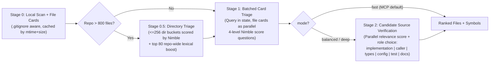

# nimble-search

**Zero-index semantic file search for coding agents (Claude Code, OpenAI Codex, Google Antigravity) powered by [Bespoke Labs Nimble](https://docs.bespokelabs.ai).**

Find the right file from a plain-English description of *what it does* — with **no vector database, no embedding pipeline, and no background indexing daemon**. Works immediately on fresh clones and uncommitted local edits.

## Quickstart

Requires **Node.js >= 20** and a Bespoke Labs API key (`BESPOKE_API_KEY`). Search requests send repository information to the configured Nimble API; see [Data sent to the API](#data-sent-to-the-api).

### Install

```bash
git clone https://github.com/bespokelabsai/nimble-search.git
cd nimble-search
npm ci
npm run build

export BESPOKE_API_KEY="your-bespoke-api-key"
```

### Search your repository

Replace `/path/to/your/repo` with the repository you want to search. These commands run from the `nimble-search` checkout you just built:

```bash
# Check the searchable files locally; makes no API calls.
node dist/cli.js scan --dir /path/to/your/repo

# Find candidate files from a description of their behavior.
node dist/cli.js "where failed requests are retried with backoff" \
  --dir /path/to/your/repo --fast --top 5
```

Without `--dir`, the CLI searches the current directory, which at this point is the `nimble-search` checkout itself.

Open the highest-ranked candidate in your editor and verify the relevant implementation. Once you know a symbol name, use `rg -n 'SYMBOL' /path/to/your/repo` for references, or `rg -l 'SYMBOL' /path/to/your/repo` if you only need filenames. If the candidates do not match, refine the description or narrow the search with `--path` or `--ext`.

### Use the short command or connect your agent

Optionally expose the CLI on your PATH:

```bash
npm link
nimble-search "where failed requests are retried with backoff" \
  --dir /path/to/your/repo --fast --top 5
```

If you skip `npm link`, replace `nimble-search` in the examples below with `node /absolute/path/to/nimble-search/dist/cli.js`.

Run `node dist/cli.js setup` to print configuration snippets with the installed paths, then follow [Agent Integration](#agent-integration-claude-code-codex--antigravity) for MCP and skill setup. `setup` prints instructions; it does not modify your agent configuration.

### Choose a search mode

| Mode | CLI | MCP `search_files` | What it does |
| --- | --- | --- | --- |
| Fast | `--fast` | Default, or `mode: "fast"` | Ranks file cards. Start here when you will read the candidate files yourself. |
| Balanced | Default (omit `--fast` and `--deep`) | `mode: "balanced"` | Adds candidate source verification and role tags. |
| Deep | `--deep` | `mode: "deep"` | Verifies up to 24 candidates. |

For role filtering, use CLI `--role implementation`, or MCP `roles: ["implementation"]` with `mode: "balanced"` (omitting MCP `mode` also selects balanced when roles are supplied). Fast results have no verified role tags.

Verification scores relevance from candidate source content. Files larger than the default **24,000-character excerpt budget** are represented by their beginning, query-matching middle sections, and end. It does not guarantee that every line was reviewed or that the code is correct; inspect the implementation before relying on it.

### Data sent to the API

The default endpoint is `https://api.bespokelabs.ai`. Every search sends your query and file cards containing relative paths, language, line counts, leading summaries/comments, and extracted symbols. Cards can also contain short code previews. Large repositories can additionally send directory summaries for triage.

Balanced and deep modes also send source content from candidate files, excerpted as described above. File discovery and the file-card cache are local; `scan` / `scan_repo` make no API calls. Searches honor `.gitignore` and `.nimbleignore` by default. Use `--base-url` or `NIMBLE_BASE_URL` for a compatible self-hosted endpoint.

### More examples

These examples assume `npm link` was run. Set `--dir` to the repository you want to search:

```bash
# Balanced search: candidate source verification and role tags.
nimble-search "where JWT refresh tokens are rotated" --dir /path/to/your/repo

# Filter to primary implementation files.
nimble-search "where MCP tools are registered" --dir /path/to/your/repo --role implementation

# Narrow a fast search by subdirectory and file extension.
nimble-search "retry failed webhooks with backoff" \
  --dir /path/to/your/repo --path services/billing --ext ts,tsx --fast

# Structured results and a timing/usage trace.
nimble-search "database migration runner" --dir /path/to/your/repo --fast --json --verbose
```

Example balanced-search output from the `nimble-search` repository:

```bash
$ nimble-search "where rate limiting, HTTP retries, and payload batch splitting happen" --dir /path/to/nimble-search --top 5

Found 5 files (25 files scanned, 8 verified, 3.6s, 25.4k tok, $0.0010):

1. 0.98 [implementation]  src/nimble/client.ts  (TypeScript, 375 lines)
   Symbols: NimbleClientOptions, NimbleApiError, NimbleClient, MAX_QUESTIONS_PER_REQUEST
2. 0.69 [test]            test/client.test.ts  (TypeScript, 108 lines)
3. 0.41 [caller]          src/search/pipeline.ts  (TypeScript, 518 lines)
4. 0.39 [caller]          src/cli.ts  (TypeScript, 389 lines)
5. 0.26 [types]           src/nimble/types.ts  (TypeScript, 81 lines)
```

The `tok` count in the output header is Nimble API input usage, not the size of the returned search results. Dollar amounts are estimates; see [Interpreting token and cost savings](#interpreting-token-and-cost-savings).

---

## When to use Nimble, grep, or a vector DB

| Approach | Strength | Weakness |
| --- | --- | --- |
| **`grep` / `ripgrep`** | Local, fast, exact for known symbols/regexes; `rg -l` returns only filenames | Behavioral queries may require trying several keywords; broad line searches can return noisy results |
| **Embeddings / Vector DB** | Cheap query time on huge repos | Needs an index kept in sync with local edits; retrieval quality depends on the embedding model |
| **`nimble-search`** | **Zero index**, sees local edits, ranks files by a behavioral description | Adds API latency and usage; savings depend on the query, repository, and grep baseline |

### When to reach for each tool

- **Use `nimble-search` (`search_files`)** when you know *what* code does conceptually, not what it's named (*"where failed webhooks are verified against replay attacks"*, *"the state machine that repairs truncated JSON"*), especially in large multi-package repos.
- **Use `grep` / `rg`** when you already have an exact identifier, error code (`ERR_...`), import path, or need exhaustive find-all-references.

---

## Architecture

`nimble-search` uses a multi-stage funnel built around Nimble's `POST /v1/systemone` API (up to 64 typed questions per request, returning calibrated continuous expected scores without generating prose):



Key design details:
- **Independent scoring (no probability splitting):** Uses Nimble's 4-level ordered `score` rubric rather than `choice` in Stage 1 so multiple relevant files all score high independently, and zero-match queries cleanly fall below `--min-score`.
- **Zero repo clutter:** Lightweight file cards (path, language, line count, top doc comment, exported/top-level symbols) are cached in OS temp storage (`$TMPDIR/nimble-search-cache/`) keyed by `(path, mtime, size)`.
- **Resilient Nimble client:** Adaptive concurrency semaphore (defaults to `16`, automatically throttles down on `429` while honoring `Retry-After`), exponential backoff on `503`/`529`, and automatic batch splitting on `>64` questions, `>750 KiB` payloads, or `504` timeouts.
- **Self-hostable:** Point `--base-url` / `NIMBLE_BASE_URL` at any compatible Nimble endpoint (e.g., open-weight `Bespoke-Nimble-9B`).

---

## Benchmarks

Evaluated live against `api.bespokelabs.ai` (`nimble-latest`) on two unfamiliar open-source repositories — **Hono** (548 files) and **`vercel/ai`** (10,015 files across 80+ packages) — across 23 ground-truth localization tasks (`eval/`).

### 1. Standalone Retrieval Quality (vs local BM25)

| Repository & Suite | Arm | Recall@1 | Recall@5 | MRR | Avg Latency | Avg Cost |
| --- | --- | ---: | ---: | ---: | ---: | ---: |
| **Hono** (548 files, 10 standard tasks) | `bm25-lexical` | 60% | 70% | 0.62 | 13ms | $0.0000 |
| | `nimble --fast` | **100%** | **100%** | **1.00** | 5.55s | $0.0024 |
| | `nimble balanced` (full-scan) | **100%** | **100%** | **1.00** | 4.89s | $0.0051 |
| **Hono** (548 files, 5 zero-keyword tasks) | `bm25-lexical` | 0% | 20% | 0.10 | 16ms | $0.0000 |
| | `nimble --fast` | **100%** | **100%** | **1.00** | 3.76s | $0.0022 |
| **`vercel/ai`** (10,015 files, 8 zero-keyword tasks) | `bm25-lexical` | 0% | 37.5% | 0.13 | 172ms | $0.0000 |
| | `nimble --fast` (dir-triage) | **100%** | **100%** | **1.00** | 6.34s | $0.0057 |
| | `nimble balanced` (dir-triage) | **100%** | **100%** | **1.00** | 5.53s | $0.0069 |

**23 / 23 tasks landed at Rank #1 (100% Recall@1, 1.00 MRR)** — including across 10,015 files via Stage 0.5 directory triage.

### 2. Head-to-Head Coding Agent A/B (`vercel/ai`, 10,015 files, 8 zero-keyword tasks)

Controlled comparison of `grep + find + read_file` vs `+ nimble-search (fast)` using identical agent prompts and mandatory `read_file` verification (measured directly from full agent transcripts, with live Nimble API latency and cost included):

| Metric (per task avg) | `grep-only` | `+ nimble fast` | Delta |
| --- | ---: | ---: | --- |
| **Exact Accuracy** | 100% (8/8) | 100% (8/8) | tied |
| **Agent Turns** | 3.88 *(max 7)* | **3.00** *(every task: 3)* | **-23%** (zero tail blowups) |
| **Tool Calls** (`grep / nimble / read`) | 3.38 (`1.75 / 0 / 1.50`) | **2.50** (`0 / 1.00 / 1.50`) | **-26%** |
| **Frontier New Input Tokens** | 17,772 *(max 25.4k)* | **14,521** | **-18.3%** (-3,251 tok) |
| **Frontier Output Tokens** | 1,218 | **967** | **-20.6%** (-251 tok) |
| **Tool-Output Context Bloat** | 10,119 chars | **6,834 chars** | **-32.5%** |
| **Hardest Tasks Wall-Clock** *(HMAC / SSRF)* | 33.0s / 21.0s | **15.6s / 15.3s** | **1.4x–2.1x faster** |
| **Nimble Spend** | \$0.0000 | **\$0.0057** | Additional search cost |

### Interpreting token and cost savings

These results describe the reported tasks and baselines above, not a guarantee for every repository. Distinguish three measurements:

- **Coding-agent context:** tokens in search results and subsequent file reads. Compact ranked results can reduce context compared with broad line-based grep, while `rg -l` can return substantially fewer tokens when useful keywords are known.
- **Nimble API usage:** additional input/output tokens processed by the search model. These are separate from the coding agent's tokens; fewer result tokens do not establish fewer total model tokens.
- **Dollar cost:** the coding agent's cost plus Nimble's cost. Include follow-up reads, output tokens, and prompt-cache pricing when comparing complete workflows.

For illustration, at assumed coding-model rates of $3 per million uncached input tokens and $15 per million output tokens, the reported reduction of 3,251 input and 251 output tokens saves about $0.0135 per task before search cost. Subtracting $0.0057 of Nimble cost leaves about $0.0078 in net savings under those assumptions. Different models, cache hits, search strategies, and follow-up reads can change the result.

The CLI's Nimble cost estimate uses a hardcoded input rate of $0.04 per million tokens and no output charge. It is an estimate, not an invoice or a live pricing lookup. To evaluate your own workflow, compare equivalent tasks and answer quality against both scoped line searches and filename-only grep, and record coding-agent usage and Nimble usage separately.

---

## Agent Integration (Claude Code, Codex & Antigravity)

Run `nimble-search setup` (or `node dist/cli.js setup`) to print copy-paste configs using the exact resolved path on your machine. Ready-to-use templates live in `configs/` and the cross-agent skill lives in [`skills/nimble-search/SKILL.md`](skills/nimble-search/SKILL.md).

### Claude Code

```bash
claude mcp add nimble-search -- node /path/to/nimble-search/dist/cli.js mcp

# Install skill so Claude Code knows when to use nimble-search vs grep
mkdir -p ~/.claude/skills/nimble-search
cp /path/to/nimble-search/skills/nimble-search/SKILL.md ~/.claude/skills/nimble-search/SKILL.md
```

### OpenAI Codex CLI

Add to `~/.codex/config.toml` (see [`configs/codex-mcp.toml`](configs/codex-mcp.toml)):

```toml
[mcp_servers.nimble_search]
command = "node"
args = ["/path/to/nimble-search/dist/cli.js", "mcp"]
env_vars = ["BESPOKE_API_KEY"]
```

```bash
mkdir -p ~/.codex/skills/nimble-search
cp /path/to/nimble-search/skills/nimble-search/SKILL.md ~/.codex/skills/nimble-search/SKILL.md
```

### Google Antigravity

Add to `~/.gemini/antigravity/mcp_config.json` (see [`configs/antigravity-mcp.json`](configs/antigravity-mcp.json)):

```json
{
  "mcpServers": {
    "nimble-search": {
      "command": "node",
      "args": ["/path/to/nimble-search/dist/cli.js", "mcp"],
      "env": {
        "BESPOKE_API_KEY": "${BESPOKE_API_KEY}"
      }
    }
  }
}
```

```bash
mkdir -p ~/.gemini/antigravity/skills/nimble-search
cp /path/to/nimble-search/skills/nimble-search/SKILL.md ~/.gemini/antigravity/skills/nimble-search/SKILL.md
```

### MCP Tools Exposed

| Tool | Description |
| --- | --- |
| `search_files` | Semantic file search by natural-language description. Defaults to `mode: "fast"` for coding agents (since the agent reads the top file directly); accepts `directory`, `subpath`, `top_k`, `mode` (`"fast" \| "balanced" \| "deep"`), `extensions`, `roles`, `min_score`, and `format`. Uses `balanced` when `roles` is supplied and `mode` is omitted; explicitly select `balanced` or `deep` for role filtering. |
| `scan_repo` | Zero-API-call inventory of searchable files, language breakdown, card cache status, and whether directory triage will trigger. |

---

## CLI Reference

```text
nimble-search "<description>" [options]
nimble-search mcp [--dir <path>] [--model <name>] [--concurrency <n>]
nimble-search scan [--dir <path>] [--path <subdir>] [--ext <ts,py>]
nimble-search setup
```

| Flag | Default | Description |
| --- | --- | --- |
| `-d, --dir <path>` | `.` | Repository root directory |
| `-p, --path <subdir>` | — | Relative subdirectory inside `--dir` |
| `-k, --top <n>` | `10` | Maximum ranked files returned |
| `--fast` | off *(CLI)* / on *(MCP)* | Stage 1 file cards only (skip Stage 2 verification) |
| `--deep` | off | Verify top 24 candidates in Stage 2 |
| `-e, --ext <list>` | all text | Comma-separated extensions (e.g. `ts,tsx,py`) |
| `-r, --role <list>` | any | Filter verified results by `implementation,caller,types,config,test,docs` |
| `--min-score <0..1>` | `0.25` | Minimum normalized relevance score |
| `--model <name>` | `nimble-latest` | Model name (or `$NIMBLE_MODEL`) |
| `--base-url <url>` | `https://api.bespokelabs.ai` | Custom/self-hosted endpoint (or `$NIMBLE_BASE_URL`) |
| `-c, --concurrency <n>` | `16` | Max concurrent requests (or `$NIMBLE_CONCURRENCY`) |
| `--batch-size <1..64>` | adaptive (up to 32) | Override file cards packed per Stage 1 request |
| `--no-cache` | off | Bypass local file-card disk cache |
| `--no-gitignore` | off | Include gitignored files |
| `--include-hidden` | off | Include dotfiles and dot-directories |
| `--json` | off | Emit structured JSON response |
| `-v, --verbose` | off | Log stage timings, token usage, cost, and retries to stderr |

You can also add a repo-level `.nimbleignore` file (same syntax as `.gitignore`) to exclude generated assets or vendored code from search.

---

## Programmatic API

```ts
import { NimbleClient, searchCodebase } from "nimble-search";

const client = new NimbleClient({
  apiKey: process.env.BESPOKE_API_KEY,
  concurrency: 16,
});

const res = await searchCodebase(client, {
  query: "validates download URLs to block SSRF against private networks",
  rootDir: "/path/to/repo",
  mode: "fast",
  topK: 5,
});

for (const match of res.results) {
  console.log(match.score.toFixed(2), match.path);
}
```

---

## Development & Evaluations

```bash
# Typecheck, build, and run unit + MCP stdio integration tests (15 tests)
npm run typecheck
npm run build
npm test

# Compile and run the retrieval benchmark (BM25 vs nimble-fast vs nimble-balanced)
npx tsc -p tsconfig.eval.json
node dist-eval/eval/run-retrieval.js /path/to/repo eval/hono-tasks.json /tmp/retrieval.json

# Run the standalone Anthropic Head-to-Head Agent A/B harness
ANTHROPIC_API_KEY=... BESPOKE_API_KEY=... \
  node dist-eval/eval/ab-harness.js --repo /path/to/repo --tasks eval/hono-tasks.json
```

### Project Layout

```text
src/
  cli.ts              CLI entrypoint (search, mcp, scan, setup)
  mcp.ts              Stdio MCP server (search_files, scan_repo)
  index.ts            Library exports
  nimble/             System One API client, retries, adaptive concurrency, types
  repo/               .gitignore walker, zero-LLM file/dir cards + cache, BM25 lexical helper
  search/             Multi-stage pipeline, rubrics/prompts, text/JSON formatting
skills/nimble-search/ Cross-agent SKILL.md for Claude Code, Codex, and Antigravity
configs/              MCP config templates (JSON & TOML)
eval/                 Retrieval & head-to-head agent A/B benchmarks
test/                 Unit & stdio MCP integration tests
```

## License

MIT
